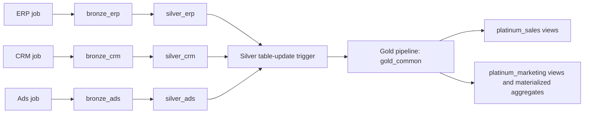

# Four-layer Databricks POC driven by ODCS

An Ifolor-style ERP, CRM and advertising example using Unity Catalog, Lakeflow Declarative Pipelines,
Lakeflow Jobs and ODCS v3.2.0. Source jobs run independently and finish at Silver. A **table-update trigger**
observes Silver changes and starts Gold. Platinum contains ordinary views over Gold and materialized
aggregates refreshed by their own Gold table-update triggers. A separate demo shows a daily completion gate.

**Upgrading an existing deployment?** Follow [the upgrade and guide-alignment walkthrough](docs/guide-alignment.md).
This revision changes key types and rebuilds derived outputs while retaining Bronze history.



## Schemas and ownership

| Schema | Contents | Owner |
|---|---|---|
| `bronze_erp`, `bronze_crm`, `bronze_ads` | Append-only streaming tables, all payload columns strings; a `landing` volume in each schema | Respective source pipeline |
| `silver_erp`, `silver_crm`, `silver_ads` | Typed, deduplicated materialized views, ERP customer change history and `contract_quarantine` | Respective source pipeline |
| `gold_common` | Persisted facts/dimensions and `data_readiness`, implemented as Lakeflow materialized views | Gold pipeline |
| `platinum_sales` | Ordinary views: `fact_sales`, `sales_detail`, `dim_customer`, `dim_product`, `dim_customer_history`, `sales_history` | Published from ODCS |
| `platinum_marketing` | Materialized aggregate `fact_campaign_performance`; ordinary view `dim_campaign` | Marketing pipeline / view publication |
| `bronze_operations` | Append-only `load_events` receipts, partitioned logically by business date and load group | Source jobs and daily gate |

There is **no schema prefix**. Set `catalog` to isolate a deployment; schema names are exactly as shown.
Gold materialized views store their results in Delta, as agreed for this POC. They are not ordinary virtual
views. Every Gold definition reads Silver directly; every Platinum definition reads Gold directly. Ordinary
Platinum views evaluate their Gold inputs when queried. The Marketing aggregate has its own refresh job.
Operational receipts control execution; they are not business inputs to Gold or Platinum datasets.

Each source has its own `src/pipelines/<source>/bronze.py` and `silver.py`. These small entrypoints register
that source's contracted datasets through shared code. All five pipelines use serverless compute.
Source jobs have no schedule by default; ODCS orchestration settings can add an independent schedule to each.
The eight Gold outputs form one commerce domain. Additional domains generate separate pipelines and jobs;
there is no requirement to put all future Gold tables in this pipeline.

## What makes Gold refresh automatically

The `refresh_gold` job has a native `table_update` trigger:

- It monitors the eight Silver interfaces referenced by Gold contracts, with `ANY_UPDATED` semantics.
- It waits for 60 seconds without another watched update and allows at least 120 seconds between triggers.
- Job concurrency is one, with queueing enabled.
- Its sole task starts a normal Gold pipeline update. Source jobs never call this job.

The **Jobs trigger detects changes and starts execution**. Lakeflow then uses its dependency graph and
refresh planner to maintain the Gold materialized views. The optimizer may reuse unchanged results,
incrementally refresh, or recompute an output; incremental execution is not guaranteed for every query.
Inspect the Gold pipeline event log for the actual plan and refresh costs.

This is eventual, progressive enrichment: a debounce window is not an atomic multi-source batch barrier.
A source can update several Silver tables at different moments. Gold can first show incomplete data and
converge on a later update. `fact_attributed_sales` exposes `ERP_ONLY`, `CRM_ENRICHED`, then `COMPLETE`.
`data_readiness` reports which sources have records and their latest timestamps. It does not certify that
all data for a business period has arrived. The separate `daily_gate_demo` demonstrates explicit source
completion receipts and a gate, including successful loads that add zero rows. A domain can select
`refresh: daily` instead of `eventual`; see [configuration and limits](docs/guide-alignment.md#daily-completion).

For a larger deployment, use refresh groups based on shared dependencies and freshness requirements, and
increase the batching window where appropriate. Do not assume one trigger can watch an unlimited number
of tables: check the workspace's current table-trigger limits. The eight-table example stays small.

## Contracts are the executable source of truth

The runtime reads the YAML with the official
[`open-data-contract-standard`](https://github.com/datacontract/open-data-contract-standard-python) library.
The library supplies the ODCS models; this project's generic interpreter executes the documented SQL subset.
ODCS itself is not a transformation engine.

| Contract field | Runtime use |
|---|---|
| `schema[].physicalName` | Output table/view address and schema creation |
| `properties[].name`, `logicalType`, `physicalType` | Ordered output columns and Spark SQL types |
| `properties[].transformLogic` | Executed Spark SQL expression for that output column |
| `properties[].transformSourceObjects` | Column lineage documentation, checked against declared object inputs |
| `required`, `enum` | Lakeflow expectations and Silver rejection rules |
| `primaryKey`, `primaryKeyPosition` | Silver deduplication keys and declared output grain |
| `unique` | Runtime uniqueness checks in Gold and Platinum |
| Root `customProperties.key_definitions` | Namespaces, hash algorithms and arity for shared `poc_key(...)` expressions |
| Root `customProperties.orchestration` | Domain ownership, refresh policies, receipts and optional schedules |
| `customProperties.poc.inputs` / `from_sql` | Input references, joins, subqueries and aggregations |
| `customProperties.poc.order_by` | Silver's deterministic latest-record ordering |
| `customProperties.poc.history` | Optional Silver business keys, effective timestamp and attributes whose changes create history versions |
| `customProperties.poc.row_checks` | Named, row-level SQL predicates; false/null causes rejection |
| `customProperties.poc.unknown_member` | Literal UNKNOWN row for each Gold dimension |
| `customProperties.poc.key_checks` | Hash-to-business-identity collision checks |
| `customProperties.poc.demo_rows` on source objects | Sample records for the staged demo |
| `customProperties.poc.demo_batches` on source objects | Named arrivals for the SCD2 and dimension-key demos |

The `poc` values are an **ODCS custom-property extension defined by this repository**, not a portable ODCS
execution standard. See [the execution profile](docs/contract-execution.md) for supported syntax and limits.
Contract files are trusted, reviewed code: changing `transformLogic` changes executed SQL. The loader checks
that object reads use declared input placeholders and the correct layer. It does not sandbox SQL functions.

Silver applies tolerant casts, records invalid rows in its source's quarantine, and keeps the latest valid
row per primary key. The customer history interface uses a composite customer/time key and additionally
collapses unchanged repeats. Gold uses strict casts and failing expectations. Gold and Platinum queries
fail on duplicate grains, declared hash collisions and row constraints. Informational primary-key declarations
are emitted for their materialized views; they are not database-enforced uniqueness constraints. Platinum
projections specify columns rather than `SELECT *`. See [key semantics](docs/guide-alignment.md#dimension-and-fact-keys).

The product split is executable YAML in [`contracts/silver/erp.odcs.yaml`](contracts/silver/erp.odcs.yaml):

```yaml
name: product_family
physicalType: STRING
transformLogic: trim(try_element_at(split(src.product_hierarchy, '[|]', -1), 1))
```

The four-part input `PHOTOBOOK|PREMIUM|A4|LANDSCAPE` produces family, tier, format and orientation.
Missing/extra/empty segments are quarantined. `try_element_at` and `TRY_CAST` prevent invalid inputs from
crashing under ANSI SQL. The raw hierarchy and original rejected payload remain available for diagnosis.

There are no business column lists, joins, SQL view definitions or embedded CSV strings in notebooks.
`demo_control.py` was removed. Generic notebooks handle storage setup, view publication and example-file
arrival. `demo/scenario.yaml` contains observations/expected results, not production transformations.

## Deploy and set up

Requirements: Databricks CLI, Python 3.11+ and uv to render deployment resources, a Unity Catalog catalog,
permission to create schemas/volumes and pipelines, serverless compute, and workspace support for table-update
triggers on the Silver materialized views.
The job run identity needs access to those Silver objects. Use your existing `medallion-poc` CLI profile.

The bundle identity remains **`medallion-architecture-poc-v2`**. The original v1 deployment and its
`medallion_poc_*` schemas remain untouched. Pause old scheduled jobs before moving to the new POC.
Do not delete or transfer ownership of the old tables. Data is not migrated automatically: upload source
files to the new volumes or use the sample-arrival demo. The new source pipelines have fresh checkpoints.

For the first deployment, generate resources without table watchers. This avoids asking the Jobs API to
watch Silver or Gold tables before they exist. Enable the triggers after setup:

```bash
git pull
UV_CACHE_DIR=/tmp/medallion-uv-cache uv sync --locked
.venv/bin/python scripts/generate_bundle_resources.py --bootstrap

databricks bundle deploy --profile medallion-poc -t dev \
  --var catalog=main --var gold_trigger_status=PAUSED --var platinum_trigger_status=PAUSED

databricks bundle run setup_poc --profile medallion-poc -t dev \
  --var catalog=main

.venv/bin/python scripts/generate_bundle_resources.py
databricks bundle deploy --profile medallion-poc -t dev \
  --var catalog=main --var gold_trigger_status=UNPAUSED --var platinum_trigger_status=UNPAUSED
```

`setup_poc` creates missing schemas/volumes/folders and the receipt table, initializes all three source
pipelines, runs Gold, initializes the Platinum aggregate, and then publishes ordinary Platinum views.
It uses no full refresh. Existing source files are processed incrementally. When converting the former
Marketing ordinary view to an MV, preparation drops only that ordinary view; raw data is retained.
The bootstrap generation is temporary; normal generation restores the checked-in watchers with the same
job/pipeline IDs. Keep both triggers absent or paused during setup. The setup notebook only prepares storage
and the view-to-MV conversion; use the setup **job** for complete initialization.

The explicit resource `pause_status` is controlled by `gold_trigger_status`. The target is named `dev`,
but deliberately omits `mode: development`: that mode forbids an UNPAUSED trigger preset and applies
development defaults that pause automatic triggers. Check **commerce Gold refresh → Schedules & Triggers**
after deployment.
Normal deployments default to UNPAUSED. Pause both trigger variables for setup/maintenance.
The setup does not require an API credential inside a notebook or notebook-driven changes to job schedules.

## Demonstrate separate arrivals

After setup and enabling the trigger, run:

```bash
databricks bundle run medallion_poc_demo --profile medallion-poc -t dev \
  --var catalog=main
```

The demo stages ERP examples, runs `ingest_erp`, then **only observes** the Gold/Platinum results until
`ERP_ONLY` appears. It repeats for CRM (`CRM_ENRICHED`) and Ads (`COMPLETE`). It never calls the Gold pipeline
or `refresh_gold`. If the automatic trigger is paused or broken, the observation task fails after 15 minutes
with a diagnostic rather than silently refreshing Gold itself. Startup and trigger delays can take minutes.

The same `OL100` order ultimately has CHF 59.80 attributed revenue, CHF 20.00 ad spend and ROAS 2.99.
This example uses a single currency; multi-currency reporting needs currency-aware grain/conversion rules. `P_BAD`
is retained in Bronze and quarantined in Silver. Ads also supplies an undeclared `placement_type`, retained
in Bronze `_rescued_data` while the Silver interface stays stable.

Run the staged sequence against an initially empty POC catalog. The demo checks that Gold readiness reports no existing
Silver records before beginning; it does not clear landing files, reset checkpoints or delete raw records.
For another full demonstration use another catalog. Identical example files are content-addressed and
never overwritten; ingestion retries do not append the same file again.

Outside the demo, upload immutable new CSV files and run only the corresponding source job:

```text
/Volumes/main/bronze_erp/landing/erp_orders/<new-file>.csv
/Volumes/main/bronze_crm/landing/crm_contacts/<new-file>.csv
/Volumes/main/bronze_ads/landing/ads_campaigns/<new-file>.csv
```

```bash
databricks bundle run ingest_crm --profile medallion-poc -t dev --var catalog=main
```

That job stops at Silver. Watch the independently triggered `refresh_gold` run, then query:

```sql
SELECT order_line_id, completeness_status FROM main.gold_common.fact_attributed_sales;
SELECT * FROM main.platinum_sales.sales_detail;
SELECT * FROM main.platinum_marketing.fact_campaign_performance;
```

After changing an ordinary Platinum view contract, run `publish_platinum_sales`, `publish_platinum_marketing`,
or `publish_platinum_views` to replace its definitions. For a Marketing aggregate expression change, deploy
and run `refresh_platinum_marketing`. Data changes in Gold need no ordinary-view republication and trigger
the Marketing MV job automatically. After changing a Gold expression without a Silver data
change, explicitly run `refresh_gold` once: table-update triggers monitor data commits, not YAML edits.

## Demonstrate SCD Type 2 customer history

The additional `scd2_demo` job shows a customer moving countries, an unchanged repeat, and a late-arriving
historical change. It can run after the enrichment demo using separate sample IDs. After installing the
new definitions with the appropriate setup or upgrade sequence, run:

```bash
databricks bundle run scd2_demo --profile medallion-poc -t dev --var catalog=main
```

`gold_common.dim_customer_history` retains versions with `customer_version_key`, `valid_from`, `valid_to`
and `is_current`. Sales facts store only the stable entity key; Platinum resolves a version by order timestamp.
Query `platinum_sales.sales_history` to see historical country values; `sales_detail` keeps current values.
The demo only ingests ERP and waits for automatically triggered Gold updates. See [the complete walkthrough](docs/scd2.md)
for upgrade commands, expected rows, contract rules, late-arrival behavior and cost considerations.

## Demonstrate missing and late dimensions

Run `key_handling_demo` after setup with automatic refresh enabled. It creates two sales: one with missing
customer/product IDs, and one with present IDs whose dimension rows arrive later. The first uses UNKNOWN
members. The second stays visible as UNMATCHED, then becomes MATCHED without changing its fact keys.
The [walkthrough](docs/guide-alignment.md) includes SQL queries, daily-gate commands and deployment limits.

## Edit and validate

Python 3.11+ and Java 17+ are required for local Spark tests:

```bash
UV_CACHE_DIR=/tmp/medallion-uv-cache uv sync --locked --extra dev
.venv/bin/python scripts/fetch_odcs_schema.py
.venv/bin/python scripts/validate_contracts.py
.venv/bin/python scripts/generate_bundle_resources.py
.venv/bin/pytest
.venv/bin/ruff check .
```

Runtime transformations read YAML directly. `generate_bundle_resources.py` only produces deployment
resources: source pipeline/job definitions and the Gold trigger's watched tables. Commit its generated
`resources/medallion_poc.yml` after changing contract names or dependencies. CI checks for drift. `--bootstrap` temporarily omits the watcher for first-time setup; restore normal
generation before committing or enabling automatic refresh.
When adding a source, also add its two small pipeline entrypoints following the existing source folders.

Local tests execute the actual Silver/Gold/Platinum SQL under Spark ANSI mode, including the three arrival
stages, SCD2 intervals/temporal joins/late corrections, output types/grains, invalid values and a changed
contract expression/output column. Registration
tests simulate Lakeflow without `__file__`; setup and example-file tests check repeatability. These tests
cannot prove Auto Loader behavior, native trigger delivery, permissions or Lakeflow incremental refresh
plans: the staged Databricks job is the workspace acceptance test.
